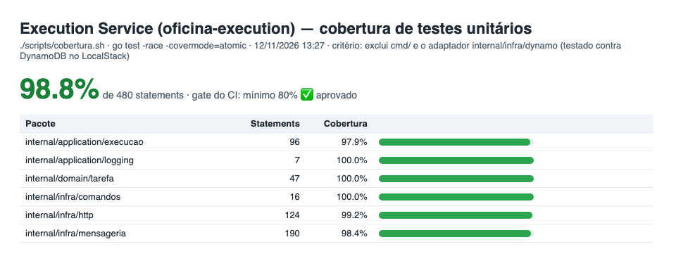

# oficina-execution — Execution Service

[](https://sonarcloud.io/summary/new_code?id=ProblemaTheu_oficina-execution)
[](https://sonarcloud.io/component_measures?id=ProblemaTheu_oficina-execution&metric=coverage)
[](https://github.com/ProblemaTheu/oficina-execution/actions/workflows/ci.yml)
[](https://github.com/ProblemaTheu/oficina-execution/actions/workflows/cd.yml)

Fila de **diagnóstico e reparo** da oficina. Um dos três microsserviços da Fase 4 do Tech Challenge (SOAT), ao lado do [OS Service](https://github.com/ProblemaTheu/oficina-app) e do [Billing Service](https://github.com/ProblemaTheu/oficina-billing).

## O que faz — e o que não faz

| Faz | Não faz |
|---|---|
| Recebe da saga `IniciarDiagnostico` e `ExecutarReparo` e põe as tarefas na **fila de execução** | Não conhece preço, orçamento nem pagamento |
| Expõe a **API do mecânico**: ver a fila, iniciar, concluir diagnóstico e reparo | Não muda o status da OS — **responde** ao orquestrador do OS Service |
| Responde à saga pela **outbox** (`DiagnosticoIniciado/Concluido/Falhou`, `ExecucaoIniciada/Concluida/Falhou`, `TarefasCanceladas`) | Não lê o banco de nenhum outro serviço |
| **Compensação** `CancelarTarefas`: cancela as tarefas não concluídas da OS | Não compensa depois do pivô: iniciado o reparo, o estoque já saiu |

**Falha simulada (F4-4.7):** com `PERMITIR_FALHA_SIMULADA=true` (só no ambiente de gravação; padrão `false`), `ExecutarReparo` para um veículo de placa `FAL*` responde `ExecucaoFalhou{motivo: falha_simulada}` — a saga, que já tem o pagamento, estorna. É o gatilho da cena de falha do vídeo.

## Tecnologias

| Tecnologia | Por quê |
|---|---|
| Go 1.26, chi | Mesmo ecossistema do OS Service |
| **Amazon DynamoDB** (single-table) | O requisito de banco **NoSQL**. A fila é acesso por chave (tarefa) e por fila/estado (GSI) — encaixe natural de chave-valor; sem servidor, custo ≈ 0, permissão por IAM |
| Amazon SQS FIFO | Comandos da saga ordenados por `saga_id` (`MessageGroupId`), DLQ após 5 tentativas |
| New Relic | APM, logs com `saga_id`/`correlation_id` e trace distribuído atravessando a fila |

## Arquitetura do serviço

```
            execution-commands.fifo                          os-saga-replies.fifo
OS Service ─────────────────────────▶ Consumidor        Relay ─────────────────────▶ OS Service
                                          │                ▲
                                          ▼                │
                   Mecânico ──JWT──▶  API HTTP ──▶ Casos de uso ──▶ DynamoDB (tarefa + inbox + outbox)
```

- **Consumidor** (`internal/infra/mensageria`): long polling, despacho por tipo, ack/reentrega/DLQ.
- **Casos de uso** (`internal/application/execucao`): regras da fila; cada escrita é **atômica** com a inbox e a outbox.
- **DynamoDB** (`internal/infra/dynamo`), tabela `execution-tarefas`:

| Item | `pk` / `sk` | Uso |
|---|---|---|
| Tarefa | `TAREFA#<id>` / `TAREFA` | Leitura por id; `gsi1` = `FILA#<tipo>#<estado>` / `<prioridade>#<criado_em>` |
| Ponteiro | `OS#<os_id>` / `TAREFA#<id>` | Tarefas de uma OS |
| Inbox | `MSG#<message_id>` / `MSG` | Idempotência do consumo (TTL 7 dias) |
| Outbox | `OUTBOX#<id>` / `OUTBOX` | Respostas à saga; `gsi1` esparso `OUTBOX#PENDENTE` |

- **Idempotência:** o efeito, a marca na inbox e as respostas vão no mesmo `TransactWriteItems` com `attribute_not_exists(pk)` — reentrega não duplica tarefa.
- **Concorrência:** iniciar/concluir grava com `ConditionExpression estado = :anterior` — dois mecânicos na mesma tarefa: o segundo recebe `409`.
- **Ordem das respostas:** o relay roda com **uma réplica** (o DynamoDB não tem advisory lock como o Postgres) — decisão registrada no plano da Fase 4 (corte 7′).
- **Prioridade da fila:** reparo antes de diagnóstico (carro já pago esperando é o pior caso); dentro do tipo, por chegada.

## API

Base `/execution/v1`, JWT do OS Service (`aud=oficina-api`, mesmo segredo `JWT_SECRET`).

| Método | Rota | Quem | Efeito / resposta à saga |
|---|---|---|---|
| GET | `/fila?tipo=DIAGNOSTICO\|REPARO` | funcionário | Tarefas aguardando, em ordem de atendimento |
| GET | `/tarefas?os_id=` | funcionário | Tarefas de uma OS |
| POST | `/tarefas/{id}/iniciar` | mecânico, administrador | `EM_ANDAMENTO` → `DiagnosticoIniciado` (diagnóstico) · **`ExecucaoIniciada`** (reparo — pivô: o OS baixa o estoque) |
| POST | `/tarefas/{id}/concluir-diagnostico` `{"diagnostico": "..."}` | mecânico, administrador | `CONCLUIDA` → `DiagnosticoConcluido` |
| POST | `/tarefas/{id}/concluir` | mecânico, administrador | Reparo `CONCLUIDA` → `ExecucaoConcluida` (OS finalizada). Exige o reparo iniciado |
| GET | `/health/live`, `/health/ready` | — | Probes (ready lê a tabela) |

Erros: `404` tarefa inexistente · `409 CONFLITO` / `TAREFA_CANCELADA` · `422 REGRA_DE_NEGOCIO` · `403` cliente ou papel sem permissão.

## Como rodar

O ambiente completo da saga fica no OS Service (`docker-compose.saga.yml`), que builda este repo da pasta irmã:

```bash
# com os dois repos lado a lado: …/oficina-app e …/oficina-execution
cd oficina-app && cp .env.example .env
docker compose -f docker-compose.saga.yml --profile saga up -d --build os execution
# OS em :8080, Execution em :8082
```

Variáveis: `DYNAMODB_TABELA`, `FILA_EXECUTION_URL` (consome), `FILA_RESPOSTAS_URL` (responde), `JWT_SECRET`, `AWS_ENDPOINT_URL` (LocalStack, só local), `NEW_RELIC_LICENSE_KEY` / `NEW_RELIC_APP_NAME` (opcionais).

## Testes e qualidade

```bash
./scripts/cobertura.sh                      # unitários com -race + gate de 80%
# integração: DynamoDB e SQS reais no LocalStack
docker run -d -p 4566:4566 -e SERVICES=dynamodb,sqs localstack/localstack:4
AWS_ENDPOINT_URL=http://localhost:4566 AWS_REGION=us-east-1 AWS_ACCESS_KEY_ID=test AWS_SECRET_ACCESS_KEY=test \
  go test -tags localstack ./internal/infra/dynamo/ ./internal/infra/mensageria/
```

**Cobertura unitária: 98,8%**, no critério do Sonar — exclui `cmd/` (bootstrap) e `internal/infra/dynamo/` (adaptador coberto pelos testes de integração contra DynamoDB real). As duas listas de exclusão ficam iguais em `scripts/cobertura.sh` e `sonar-project.properties`.

### Evidências de cobertura e de proteção da `main`



Gerado por `./scripts/cobertura.sh` (o mesmo gate de **80%** que roda no CI e no job de testes do CD, antes do build da imagem). A cobertura publicada no SonarCloud usa o mesmo critério: badge **Coverage** no topo deste README.

A `main` é protegida por ruleset: só entra por **pull request aprovado**, sem push direto, sem force-push e sem deleção. Prova em [`docs/evidencias/push-main-rejeitado.txt`](docs/evidencias/push-main-rejeitado.txt): `push declined due to repository rule violations`.

| Check do CI | O que valida |
|---|---|
| `Build e testes` | build, testes com `-race`, **cobertura ≥ 80%** |
| `Lint` | golangci-lint (mesma config do OS Service) |
| `gitleaks` | segredos no histórico |
| `Integração (LocalStack)` | idempotência, escrita condicional, fila, outbox/relay, SQS FIFO e DLQ |
| `SonarCloud` | quality gate (`sonar.qualitygate.wait=true` — o job falha se o gate reprovar) |

## Documentação

| Documento | Conteúdo |
|---|---|
| [docs/arquitetura.md](docs/arquitetura.md) | Componentes, mensagens consumidas/produzidas, modelo de dados |
| [docs/openapi.yaml](docs/openapi.yaml) | Contrato da API (OpenAPI 3) |
| [Arquitetura da Fase 4](https://github.com/ProblemaTheu/oficina-app/blob/main/docs/planejamentos/fase-4/arquitetura.md) | Os 3 serviços, a saga e o catálogo de mensagens |
| [RFC-006 — Saga](https://github.com/ProblemaTheu/oficina-app/blob/main/docs/rfcs/RFC-006-saga-e-consistencia-distribuida.md) · [ADRs 009–016](https://github.com/ProblemaTheu/oficina-app/blob/main/docs/architecture-decisions.md) | Decisões |
| [Coleção Postman da Fase 4](https://github.com/ProblemaTheu/oficina-app/blob/main/docs/postman/fase-4-saga.json) | Fluxo completo da saga |

## Ambientes

Só `prod` é implantado; homologação dispensada conforme orientação do fórum (mesma decisão da Fase 3).

## Infraestrutura e deploy

| Pasta | O que tem |
|---|---|
| [`infra/`](infra/) | Terraform **do serviço**: fila `execution-commands.fifo` + DLQ (redrive após 5), **tabela DynamoDB `execution-tarefas`** (on-demand, GSI `gsi1`, TTL, PITR, criptografada), role do pod por **EKS Pod Identity** (só a própria tabela e fila; envia só para `os-saga-replies.fifo`), alarme da DLQ (CloudWatch + SNS) e o contrato SSM |
| [`k8s/`](k8s/) | `base` (ServiceAccount, ConfigMap, Deployment com 1 réplica e estratégia `Recreate`, Service) + `overlays/prod` (namespace `execution-prod`, Classic Load Balancer, falha simulada `FAL*` ligada para a gravação) |
| [`.github/workflows/cd.yml`](.github/workflows/cd.yml) | `Testes (gate de 80%)` → `Build e push` (Docker Hub, tag = SHA) → `Deploy no EKS` (SSM → ConfigMap `execution-ambiente`, `kubectl apply -k`, `rollout status`, smoke `/health/ready`, rollback automático, marcador no New Relic) |

O deploy só roda com a variable `DEPLOY_ENABLED=true` (sem cluster, a imagem continua sendo publicada a cada merge). O `infra/` é aplicado localmente (corte 15 do plano: a role de CD só descreve o cluster e lê a SSM).

**Ordem na primeira subida** (a partir do `oficina-infra-k8s` aplicado, com os namespaces e as access entries):

```bash
cd infra && terraform init && terraform apply        # fila, tabela, role do pod, SSM
./scripts/prod-secret.sh                             # Secret execution-secrets (JWT compartilhado)
gh workflow run cd.yml                               # ou merge na main
```

Contrato SSM publicado: `/oficina/prod/execution/fila-comandos-url`, `/oficina/prod/execution/dynamodb-tabela`. Consumido: `/oficina/shared/eks/cluster_name`, `/oficina/prod/os/fila-respostas-url`.

**Isolamento de dados:** a role `oficina-execution-pod` não tem permissão em RDS, Secrets Manager nem nas filas do Billing — `aws iam simulate-principal-policy --policy-source-arn <role> --action-names rds-db:connect sqs:ReceiveMessage --resource-arns <arn da billing-commands.fifo>` devolve `implicitDeny`.
