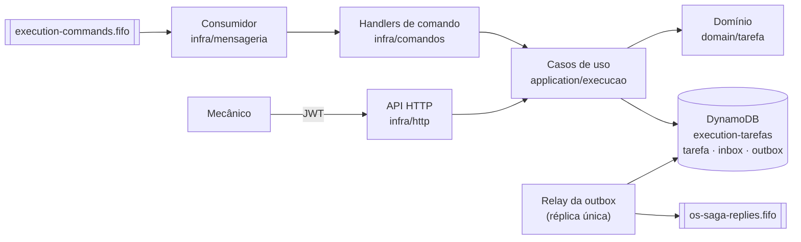
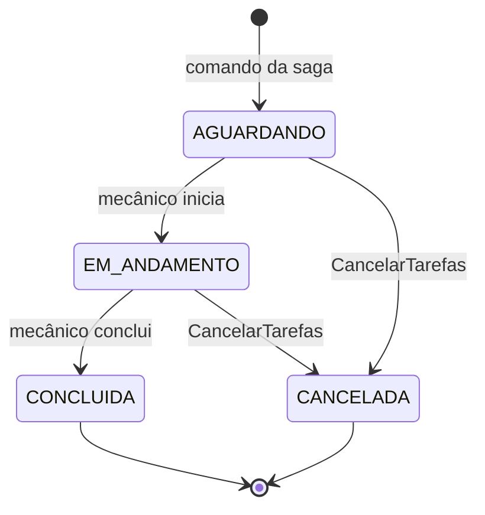

# Arquitetura — Execution Service

> Visão do serviço dentro da saga da Fase 4. O desenho completo do sistema está em [`oficina-app/docs/planejamentos/fase-4/arquitetura.md`](https://github.com/ProblemaTheu/oficina-app/blob/main/docs/planejamentos/fase-4/arquitetura.md); as decisões, nas [ADRs 009–016](https://github.com/ProblemaTheu/oficina-app/blob/main/docs/architecture-decisions.md).

## 1. Componentes

| Pacote | Papel |
|---|---|
| `internal/domain/tarefa` | Tarefa (`DIAGNOSTICO`/`REPARO`) e sua máquina de estados; regra da placa de falha simulada |
| `internal/application/execucao` | Casos de uso: criar tarefa a partir de comando, iniciar, concluir, cancelar, listar fila; monta as respostas à saga |
| `internal/infra/dynamo` | Adaptador *single-table*: escrita atômica (`TransactWriteItems`) de efeito + inbox + outbox; leitura da fila pelo GSI |
| `internal/infra/mensageria` | Envelope, consumer SQS, publisher e relay (mesmo código do OS Service — ADR-013) |
| `internal/infra/comandos` | Traduz comandos da saga em chamadas aos casos de uso |
| `internal/infra/http` | API do mecânico e probes |

## 2. Mensagens

| Consome (`execution-commands.fifo`) | Efeito | Responde |
|---|---|---|
| `IniciarDiagnostico` | Tarefa `DIAGNOSTICO` na fila | — (sem placa: `DiagnosticoFalhou`) |
| `ExecutarReparo` | Tarefa `REPARO` na fila | — (sem placa ou `FAL*` com falha simulada ligada: `ExecucaoFalhou`) |
| `CancelarTarefas` | Cancela as tarefas não concluídas da OS | `TarefasCanceladas{quantidade}` |

| Produz por ação do mecânico | Gatilho |
|---|---|
| `DiagnosticoIniciado` | `POST /tarefas/{id}/iniciar` (diagnóstico) — informativo: OS vai para `em_diagnostico` |
| `DiagnosticoConcluido{diagnostico}` | `POST /tarefas/{id}/concluir-diagnostico` |
| `ExecucaoIniciada{iniciado_em}` | `POST /tarefas/{id}/iniciar` (reparo) — **pivô T6**: o OS baixa o estoque |
| `ExecucaoConcluida` | `POST /tarefas/{id}/concluir` |

## 3. Máquina de estados da tarefa

Tarefa concluída nunca é cancelada. Na prática a saga só envia `CancelarTarefas` antes do pivô — um reparo iniciado já gerou `ExecucaoIniciada` e não é mais compensado.

## 4. Modelo de dados (DynamoDB, *single-table*)

Tabela `execution-tarefas`, chave `pk`/`sk`, GSI `gsi1` (`gsi1pk`/`gsi1sk`):

| Item | `pk` | `sk` | `gsi1pk` / `gsi1sk` | Atributos |
|---|---|---|---|---|
| Tarefa | `TAREFA#<id>` | `TAREFA` | `FILA#<tipo>#<estado>` / `<prioridade>#<criado_em>#<id>` | `os_id`, `saga_id`, `tipo`, `estado`, `placa`, `modelo`, `descricao`, `mecanico`, `diagnostico`, datas |
| Ponteiro OS → tarefa | `OS#<os_id>` | `TAREFA#<id>` | — | — |
| Inbox | `MSG#<message_id>` | `MSG` | — | `tipo`, `ttl` (7 dias) |
| Outbox | `OUTBOX#<id>` | `OUTBOX` | `OUTBOX#PENDENTE` (esparso) / `<criado_em>` | `envelope`, `trace` |

| Padrão de acesso | Como |
|---|---|
| Tarefa por id | `GetItem(TAREFA#id)` |
| Tarefas de uma OS | `Query(pk = OS#os_id, sk begins_with TAREFA#)` + `GetItem` de cada tarefa |
| Fila por tipo | `Query(gsi1pk = FILA#REPARO#AGUARDANDO)`, ordenada por `gsi1sk` |
| Respostas pendentes | `Query(gsi1pk = OUTBOX#PENDENTE)`; ao publicar, o atributo é removido |

- **Idempotência:** efeito + inbox + outbox num só `TransactWriteItems`, com `attribute_not_exists(pk)` na inbox.
- **Concorrência:** `ConditionExpression estado = :anterior` — dois mecânicos na mesma tarefa: o segundo recebe `409`.

## 5. Limites assumidos

- **Relay com réplica única:** o DynamoDB não tem *advisory lock*; a ordem das respostas por saga depende de um só publicador. O `Deployment` fica com `replicas: 1` (sem HPA).
- **Falha simulada** só com `PERMITIR_FALHA_SIMULADA=true`, usada para gravar a cena de compensação.
